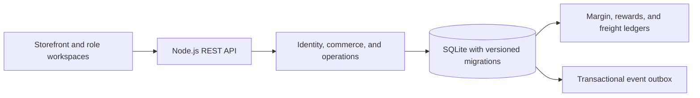

# World Souk & Shop

World Souk & Shop connects buyers directly with manufacturers. This repository implements a local marketplace from the October 2026 v2.1 proposal, with consumer, manufacturer, freight partner, and administrator workflows. The demo uses fictional businesses, original generated product photography, and simulated payments and settlement.

[Project status](STATUS.md) tracks the proposal milestones, verification, and deployment dependencies.

## Run the demo

From the project folder on Windows, use the launcher. It looks for Node.js 24.12+ first and can use a compatible VS Code runtime when Node.js is missing. The execution policy override applies to this PowerShell process.

```powershell
powershell.exe -NoProfile -ExecutionPolicy RemoteSigned -File .\scripts\start-demo.ps1
```

With Node.js 24.12+ on your path, the equivalent command is `npm run demo`. There are no packages to install. Open [the local marketplace](http://127.0.0.1:3000), select **Sign in**, and choose a **Demo role**. Use `-Port 3100` on the Windows launcher if port 3000 is in use.

| Role | Workflow |
| --- | --- |
| **Shopper** | Search and compare products, inspect manufacturer origins, buy at retail or quantity-based wholesale prices, join a group pool, and view orders, shipment history, and wallet credits. Create a referral link from the account menu. |
| **Manufacturer** | List products, edit prices and inventory, set reorder thresholds, record raw materials and lots, open buying pools, and view margin and ROI for posted sales. |
| **Freight partner** | View assigned orders, enter carrier milestones, and review regional remittance records. |
| **Administrator** | Review manufacturer or freight membership applications, assign paid orders to a carrier, review the commission split, and record and settle freight ledgers. |

To test the full order lifecycle, place a demo order for the **Sapa Linen Throw**, switch to **Administrator** and assign a waybill, then switch to **Freight partner** and record **In transit** and **Delivered**. Switch back to **Shopper** and open the order to see the timeline. The manufacturer's dashboard reflects the sale. Administrator and freight privileges are available on the local demo because it binds to loopback.

**简体中文** translates the storefront, seeded catalog and pool copy, and common shopper controls. Business workflows, some shopper messages, and user-entered records are in their original language.

## Business rules

- Stock reservations, order lines, commission, and event records commit together. Checkout uses prices from the database and snapshots unit cost and price in the order. An idempotency key makes repeated submissions safe.
- Group buying reserves stock while a pool is open. Reaching its target posts payment and cashback for its pending orders. On expiry the application cancels pending orders and returns stock. Transactional updates prevent negative inventory. The server checks for expiry on requests and once per minute.
- The 8% baseline commission is configurable. Shares are 50% platform operations, 30% shopper cashback, 10% affiliate allocation, and 10% pool growth reserve. Rounding preserves the total to the cent. A valid cross-account referral assigns the affiliate share to the referrer. The proposal's $500 order at 10% yields $25, $15, $5, and $5.
- Freight remittances record an amount and a defect allowance against a shipment and a manufacturer on that order. Settlement requires delivery. Settled net freight is included in manufacturer margin and ROI.
- Manufacturer and freight applications start in review. Approval provisions a verified profile and changes the account's role. Consumers can shop immediately and can also submit a free membership record.

## Application and data



The browser uses native HTML, CSS, and JavaScript. The Node server uses SQLite in WAL mode and checks migration checksums on startup. Prepared statements, role- and record-level authorization, hashed session tokens, scrypt passwords, same-origin mutation checks, and security headers provide the local application controls. The application uses one process, one currency, and a durable local data directory. The [production data design](infra/README.md) includes a PostgreSQL migration with materialized reporting views and describes the Kafka delivery and cloud integration contract.

| Setting | Default |
| --- | --- |
| `WSS_HOST` | `127.0.0.1`. Demo mode requires loopback. |
| `WSS_PORT` | `3000` |
| `WSS_DB` | `data/demo.sqlite` in demo mode and `data/world-souk.sqlite` otherwise |
| `WSS_COMMISSION_BPS` | `800` basis points |
| `WSS_PUBLIC_ORIGIN` | Required to be HTTPS when running the non-demo service beyond loopback. Supply the exact browser origin and terminate TLS at the reverse proxy. |

`npm start` launches the non-demo service. It starts with an empty catalog on a fresh database. Simulated checkout and demo identities are disabled in this mode. A payment adapter and operator provisioning are needed for a commercial deployment.

## Verification and operations

```sh
npm test
npm run backup -- data/demo.sqlite data/demo-snapshot.sqlite
```

The tests exercise the HTTP API and domain invariants, including checkout retries, inventory, pool expiry, referral credits, role isolation, membership activation, shipment milestones, remittance settlement, and report reconciliation. To run the Chromium smoke test, set `WSS_BROWSER` to a Chrome or Chromium executable and run `node scripts/browser-smoke.mjs`. It starts an isolated local application, checks keyboard focus, filter and language controls, checkout, order tracking, admin access, and responsive layout, then stops both processes.

The backup command makes an online SQLite snapshot, validates integrity and foreign keys, and creates a new file on a filesystem supporting hard links. Use a new destination filename. Restore to a fresh database path, verify the backup, then point `WSS_DB` at it during the maintenance window. Treat database and backup contents as sensitive because they contain account and delivery details.

The Dockerfile runs the service as a non-root user with a persistent volume. The GitHub Actions workflow tests Node releases on Windows and Linux and includes a Linux container health check.

```sh
docker build -t world-souk .
docker run --rm -p 127.0.0.1:3000:3000 -v world-souk:/data \
  -e WSS_PUBLIC_ORIGIN=https://shop.example.test world-souk
```

## Launch backlog

| Increment | Acceptance criteria |
| --- | --- |
| **Production data and delivery** | Connect the application to PostgreSQL, prove concurrent inventory and retry behavior against it, publish committed outbox messages through Kafka, and exercise reporting refresh, recovery, and load targets. Provision the EKS/Terraform environment with the owner's cloud account and operating constraints. |
| **Commerce and freight providers** | Reconcile provider authorization, capture, failed captures, refunds, rebates, and payouts. Integrate approved 3PLs, estimate shipping and landed cost per destination, and validate customs, duties, tax invoices, and shipment SLAs for each launch corridor. |
| **Regional pilot** | Onboard and verify real factories and carriers in the first operating corridor. Confirm the legal entity, contracts, consumer disclosures, currency and settlement rules, and escalation contacts per market. Treat the proposal's forecasts as planning assumptions. |
| **Release assurance** | Verify privacy request fulfillment, identity and retention procedures, backup restoration, PCI obligations, service security, keyboard and screen-reader operation, contrast, and horizontal reflow before using real accounts or payment data. |

The demo supplies a privacy notice, authenticated JSON data export, and a correction or erasure request intake queue. Production still requires an operator process for verification, response, retention exceptions, and fulfillment. [EU GDPR text](https://eur-lex.europa.eu/legal-content/EN/TXT/?uri=CELEX:32016R0679) · [California Privacy Protection Agency](https://cppa.ca.gov/faq)

Checkout stores no card data. A live hosted payment integration still needs a PCI scope and validation decision with the processor. [PCI Security Standards Council](https://www.pcisecuritystandards.org/faqs/1588/)

The interface uses landmarks, labeled controls, live status messages, visible focus, native dialogs, and mobile layouts. Browser smoke checks verified parts of keyboard and reflow behavior. A manual assistive-technology audit is pending for the proposal's WCAG 2.1 AA target. [W3C WCAG 2.1](https://www.w3.org/TR/WCAG21/)

## Storefront images

The built-in image generation tool produced the source photos. The final JPEGs are in [public/images](public/images).

- `souk.jpg` was generated with this brief. “Photorealistic editorial marketplace hero photograph, landscape 3:2. A warm, modern Asian textile workshop full of tactile woven fabric bolts in burnt ochre, dark olive, moss, linen and plum. A maker wearing a natural olive work shirt at the right side examines a roll of rust fabric on a clean wood cutting table, eyes turned away, candid craft documentary, daylight from side industrial windows. Neat rows of beautifully textured soft goods and a few plain brown shipping packages remind the viewer of direct-from-maker commerce. Authentic visual language, beautiful soft sunlight and deep shaded greens, natural grain, clear inviting scene. Frame generously, no logos or words, no watermarks or interface.”
- `throw.jpg`, `speaker.jpg`, `cups.jpg`, and `pack.jpg` were generated with this brief. “A precisely aligned 2 by 2 grid with no gutters or text, four separate independent ecommerce studio product photographs for individual catalog thumbnails, editorial design consistency. Entire canvas square. Top left photograph a carefully folded oatmeal and olive striped linen throw with visible natural fibers on a clean cream studio backdrop. Top right photograph an unbranded compact charcoal and muted dark green portable bluetooth speaker with fine textile grill and carrying loop on a very pale mint studio backdrop. Bottom left photograph a glazed ivory ceramic cup pair with warm sand handles and little espresso saucers on a very pale pink clay studio backdrop. Bottom right photograph a forest green roll-top canvas commuter backpack with simple slate webbing and buckles on pale warm gray studio backdrop. One object or set centered within each quarter, generous breathing room inside quarters, never cross quarter borders, soft directional shadows, tactile detail, editorial product photography. No lettering, no graphics, no labels, no watermark.”
